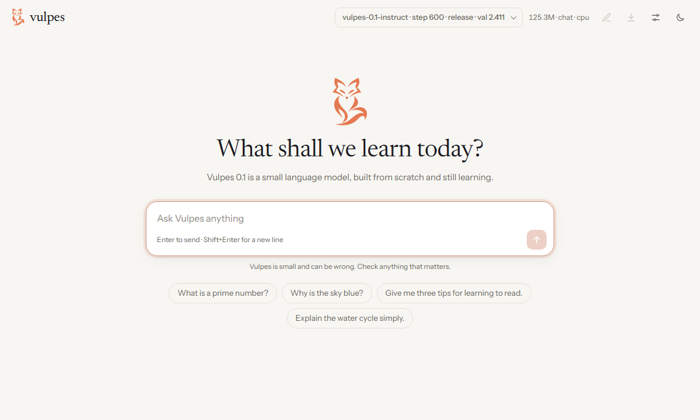

<p align="center">
  <picture>
    <source media="(prefers-color-scheme: dark)" srcset="docs/assets/wordmark-dark.svg">
    
  </picture>
</p>

<p align="center">
  A small English language model, built completely from scratch:<br>
  tokenizer, model, training and chat, on one home GPU with 4 GB of memory.
</p>

<p align="center">
  <a href="https://github.com/eyboss202/Aupus-AI/actions/workflows/ci.yml"></a>
  <a href="LICENSE"></a>
  
  
  
</p>

<p align="center">
  <a href="docs/TRAINING.md">Train it yourself</a> ·
  <a href="docs/RUNPOD.md">Train on RunPod</a> ·
  <a href="MODEL_CARD.md">Model card</a> ·
  <a href="docs/DATA.md">Data</a> ·
  <a href="docs/IDENTITY.md">Identity guide</a> ·
  <a href="docs/PLAN.md">Plan and measurements</a> ·
  <a href="CONTRIBUTING.md">Contributing</a>
</p>

<p align="center">
  <picture>
    <source media="(prefers-color-scheme: dark)" srcset="docs/assets/web-chat-dark.png">
    
  </picture>
</p>

---

**Aupus 0.1** is a small English language model that writes text and answers simple
questions, built **completely from scratch**: tokenizer, transformer, training loop,
fine-tuning and inference engine are all written in this repository with plain
PyTorch. There are no pretrained weights, no external model APIs and no high-level
model libraries.

It is also a learning project. The code is meant to be read: docstrings explain
*why* each piece exists, not just what it does.

> **Status: pre-alpha.** Every stage is written and tested: tokenizer, data pipeline,
> pretraining, evaluation, fine-tuning, chat (terminal and browser) and release export. The
> 2.94B-token training set is built, a small `tiny` model has been trained end to end, and the
> real 125M model has run a 1-hour pilot through every later stage on a 4 GB GTX 1650 Super.
> The full Aupus 0.1 training run (~16–17 days on that GPU) hasn't been done yet. The roadmap below
> shows what exists today. Weights will be published on GitHub Releases once trained; they are
> never committed to this repository. What the models are and aren't good for:
> [`MODEL_CARD.md`](MODEL_CARD.md).

## Why from scratch?

Most small open models are trained with large frameworks that hide the
interesting parts. Aupus does every step itself, so each one can be read,
tested and changed:

| Part | What we write ourselves |
|---|---|
| Tokenizer | Byte-level BPE: training (incremental pair counts), GPT-style regex pre-tokenization, lossless encode/decode, special tokens, our own JSON format |
| Data | Streaming download, Unicode normalisation, quality filters, exact + MinHash near-dedup, `uint16` token shards, deterministic resumable dataloader |
| Model | Llama-style decoder: RMSNorm, RoPE, grouped-query attention, SwiGLU, tied embeddings, KV cache |
| Training | AdamW (no decay on norms/embeddings), warmup + cosine schedule, bf16/fp16 autocast, gradient accumulation, `torch.compile` with eager fallback, bit-exact checkpoint resume, Ctrl-C-safe stops, TensorBoard |
| Fine-tuning | Chat template + supervised fine-tuning on human-written conversations, loss on assistant tokens only |
| Evaluation | Validation perplexity and our own log-likelihood harness for HellaSwag, ARC-Easy and PIQA |

**Rules we hold ourselves to:** only human-written, openly licensed training data
(no LLM-generated instruction sets); no `transformers` / `peft` / `trl` /
`accelerate` / `tokenizers` / nanoGPT / LitGPT. Dependencies are PyTorch, NumPy,
PyYAML, safetensors (serialization only), tqdm, TensorBoard and, for downloading
raw text only, Hugging Face `datasets`.

## The model

The planned Aupus 0.1 shape is the `small` preset (`configs/model/small.yaml`):

| | |
|---|---|
| Parameters | 125.3M (100.7M non-embedding) |
| Layers / width | 16 × 768 |
| Attention | 12 query heads, 4 key/value heads (GQA), RoPE, context 1024 |
| MLP | SwiGLU, hidden 2048 |
| Vocabulary | 32,000 byte-level BPE tokens |
| Training data (planned) | ~2.5B tokens of [FineWeb-Edu](https://huggingface.co/datasets/HuggingFaceFW/fineweb-edu) (ODC-By 1.0) |
| Fine-tuning data (planned) | OpenAssistant oasst1/oasst2 (Apache-2.0), Databricks Dolly 15k (CC BY-SA 3.0), a small hand-written identity set |

**Honest expectations:** a 125M model trained on a single GPU writes fluent
English and answers simple questions, but it **will** hallucinate facts and
can't reason like large commercial models. It is a learning and research
artifact, not an assistant to rely on.

The full plan, hardware analysis and measured throughput are in
[`docs/PLAN.md`](docs/PLAN.md).

## Roadmap

| # | Milestone | Status |
|---|---|---|
| 1 | Hardware check, throughput benchmark, plan | ✅ done |
| 2 | Project skeleton, configs, tests, CI, license | ✅ done |
| 3 | Byte-level BPE tokenizer | ✅ done |
| 4 | Model architecture (+ overfit test) | ✅ done |
| 5 | Data pipeline on a small sample | ✅ done |
| 6 | Pretraining loop + end-to-end `tiny` run | ✅ done |
| 7 | Full data preparation | ✅ done: 2.94B training tokens |
| 8 | Aupus 0.1 Base pretraining | ⏳ configured (`small`, 2.5B tokens) and tested with a 1-hour pilot; planned on a rented RTX 4090 (~13–17 h, [`docs/RUNPOD.md`](docs/RUNPOD.md)), or ~16–17 days on a GTX 1650 Super; not started yet |
| 9 | Evaluation harness + results | 🚧 harness done and tested on the GPU (~14 min per full run); results need the trained model |
| 10 | Supervised fine-tuning → Aupus 0.1 Instruct | 🚧 code and data done, dry-run on the GPU (~3.5 h); run needs Base (and `data/identity.jsonl`) |
| 11 | `generate` / `chat` CLI, browser chat, release export | ✅ done |
| 12 | Model card, data card, contributing and training guides | 🚧 done; the trained model's numbers are filled in after training |

## Getting started (development)

Requirements: Python 3.11+ on Linux, macOS or Windows. A GPU isn't needed for development
or tests; everything runs on CPU with the tiny `debug` preset.

```bash
git clone <repo-url> && cd Aupus-AI
python -m venv .venv && source .venv/bin/activate

# 1. Install PyTorch for your machine first:
pip install torch --index-url https://download.pytorch.org/whl/cpu      # CPU only
# pip install torch --index-url https://download.pytorch.org/whl/cu126  # NVIDIA GPU (pick your CUDA version)

# 2. Install Aupus in editable mode with dev tools
pip install -e ".[dev]"
```

Useful commands:

```bash
pytest                                   # test suite
ruff check . && ruff format --check .    # lint + format check
python scripts/check_env.py              # what hardware does this machine have?
python scripts/model_info.py             # exact params and FLOPs/token for every preset
python scripts/benchmark_throughput.py --presets tiny --micro-batch 4   # training tokens/sec (CPU or CUDA)
```

### Tokenizer

The trained 32k tokenizer is committed at `data/tokenizer/aupus-bpe-32k.json`
(with a readable `aupus-bpe-32k.vocab.txt` and measured `aupus-bpe-32k.stats.json`).

```python
from aupus.tokenizer import EOS, Tokenizer

tok = Tokenizer.load("data/tokenizer/aupus-bpe-32k.json")
ids = tok.encode("Hello, world!")  # special-token strings in text stay plain text
tok.decode(ids)  # 'Hello, world!'
tok.special_id(EOS)  # 31994
```

To reproduce it (downloads ~310 MB of FineWeb-Edu text):

```bash
pip install -e ".[data]"
python scripts/download_tokenizer_sample.py   # data/tokenizer_sample/{train,heldout}.jsonl
python scripts/train_tokenizer.py             # data/tokenizer/aupus-bpe-32k.{json,vocab.txt,stats.json}
```

### Data

Normalise → filter → dedup (exact + MinHash) → split → tokenize → `uint16` shards.
See [`docs/DATA.md`](docs/DATA.md) for every rule and the measured results.

```bash
python scripts/prepare_data.py --input data/tokenizer_sample/train.jsonl --out data/pretrain/sample

# Full set for Aupus 0.1 (Milestone 7): 8.6 GB download, then ~70 min of CPU with --workers 3
# (2.94B train tokens, 5.5 GB of shards)
python scripts/download_fineweb_edu.py --files 4
python scripts/prepare_data.py --source parquet --input data/raw/fineweb_edu --out data/pretrain/fineweb_edu
```

### Training

**To train Aupus 0.1 yourself, follow [`docs/TRAINING.md`](docs/TRAINING.md)**: a step-by-step
guide from a fresh clone to a chat model, including what the log means and what to do when
something goes wrong. The essentials, run from the repository folder with the virtual
environment active (Windows: `.venv\Scripts\activate`; Linux/macOS: `source .venv/bin/activate`):

| What | Command |
|---|---|
| **Start** (the first time only) | `python scripts/train.py --config configs/train/small.yaml` |
| **Stop safely** | Press **Ctrl-C once** in the training window and wait for the `saved ...` line (up to ~3 min: it finishes the current step first) |
| **Resume** (after every stop, crash or reboot) | `python scripts/train.py --resume runs/aupus-0.1-base` |
| **Progress and GPU use** (in a second terminal) | `python scripts/train_status.py --watch 30` |
| **Graphs** (in a second terminal) | `tensorboard --logdir runs`, then open http://localhost:6006 |
| **On a rented GPU instead** | [`docs/RUNPOD.md`](docs/RUNPOD.md): the same run on an RTX 4090 in ~13–17 h for ~5–6 USD, set up, trained, copied to the PC and stopped by `scripts/runpod/` |

The run is `small` (125M parameters) for 2.5B tokens: ~16–17 days of training on a 4 GB GTX
1650 Super, with as many stops as you like. Resuming continues bit for bit where it stopped;
a crash or power cut loses at most the ~25 minutes since the last automatic checkpoint. Never
start the same run with `--config` again (it refuses rather than overwrite it), and stop
training before gaming: a game and training on the same 4 GB card slow each other ~4×.

`train_status.py` only reads the run's files, so it never disturbs training. It shows:

```
Aupus training: runs/aupus-0.1-base
  progress    step 1 / 9,537  (0.0%)  [..............................]
  tokens      0.3M / 2.50B
  speed       1,833 tok/s, ~143 s per step
  time left   ~15 d 18 h of training (stops not counted)
  train loss  10.518
  val loss    best 10.521 at step 0 (started at 10.52)
  checkpoint  none yet (the first one is written at step 10)
  GPU now     71 °C · 91 W · 100% busy · 3.2 / 4.0 GB memory
```

One YAML file per run in `configs/train/` (strict: a typo in a key is an error). Any key can
be overridden on the command line, and dotted keys reach nested settings:

```bash
python scripts/train.py --config configs/train/tiny.yaml                     # new run -> runs/tiny/
python scripts/train.py --config configs/train/tiny.yaml max_steps=200 optim.lr=2e-3 run_name=tiny-lr2e3
python scripts/train.py --resume runs/tiny                                   # continue after Ctrl-C or a crash
tensorboard --logdir runs                                                    # loss, LR, grad norm, tok/s, samples
```

A run writes everything to `runs/<run_name>/`: the resolved `config.yaml` and `model.yaml`,
`train.log`, `metrics.jsonl`, TensorBoard events, the newest checkpoints (`step_NNNNNN.pt`)
and `best.pt` (lowest validation loss). Press Ctrl-C once to finish the current step, save and
exit. Resuming continues bit for bit where the run stopped, with the same data order and no
repeated or skipped batches.

`precision: auto` uses bf16 on Ampere and newer GPUs and fp32 everywhere else. `compile: true`
uses `torch.compile` where it works and falls back to eager mode where it doesn't (e.g. Windows,
which has no Triton).

**Milestone 6 check run** (`configs/train/tiny.yaml`, 34M params, 19.7M tokens, ~44 min on a
GTX 1650 Super): validation loss fell from 10.48 (a uniform guess over 32k tokens) to 4.95
(perplexity 141), and a hard kill + `--resume` reproduced the original losses exactly. Samples
for the prompt "In 1492, Christopher Columbus":

| Step | Continuation |
|---|---|
| 0 | `overnight overnight250Dem placebo clips legal Linda…` |
| 200 | `is an overview. The results were shown that it was a number of all time…` |
| 1200 | `was an officer. He was a professor of medicine, a professor and a biologist from the University of Virginia…` |

Fluent-looking and factually meaningless, as expected for that size. Details are in
[`docs/PLAN.md`](docs/PLAN.md) §15.

### Evaluation

Zero-shot HellaSwag, ARC-Easy and PIQA (the answer the model finds most likely wins) and
validation perplexity / bits per byte. Prompt formats follow lm-evaluation-harness, so
results are comparable with published numbers.

```bash
python scripts/download_eval_data.py                     # ~7 MB, pinned revisions -> data/eval/
python scripts/evaluate.py --model runs/tiny/best.pt --val-data data/pretrain/sample
python scripts/evaluate.py --model runs/tiny/best.pt --tasks piqa --limit 200      # quick look
```

### Fine-tuning (Base → Instruct)

Human-written conversations (OpenAssistant oasst2, Dolly 15k, a hand-written identity set),
loss only on the assistant's replies, early stopping on validation loss
([`docs/DATA.md`](docs/DATA.md) has the sources and filters).

```bash
python scripts/prepare_sft_data.py                                       # ~80 MB -> data/sft/
python scripts/sft.py --config configs/sft/aupus-0.1-instruct.yaml       # starts from runs/aupus-0.1-base/best.pt
python scripts/sft.py --resume runs/aupus-0.1-instruct
```

### Chat, generation and release

```bash
python scripts/chat_web.py --model release/aupus-0.1-instruct            # chat in the browser: http://127.0.0.1:8000
python scripts/chat.py --model runs/aupus-0.1-instruct/best.pt           # chat in the terminal: /help lists the commands; Ctrl-C stops a reply
python scripts/generate.py --model runs/tiny/best.pt --prompt "The water cycle is"
python scripts/export_release.py --checkpoint runs/aupus-0.1-instruct/best.pt --out release/aupus-0.1-instruct
python scripts/chat.py --model release/aupus-0.1-instruct                # releases load the same way
```

A release directory holds weights only (`model.safetensors`, fp32 or `--dtype bf16`), the model
config, the tokenizer, `release.json` (source checkpoint, step, val loss, SHA-256s), the license
and the model card.

The browser chat streams replies as they are written and has a Stop button, a "New chat"
button (with Undo) and the sampling settings. Under a reply are Copy, "Try again", the model that
wrote it, its length in tokens and its speed; "Edit" (or the Up arrow in an empty box) puts your
last message back in the box. A small meter in the message box shows how much of the model's
1,024-token memory the conversation fills. A model picker at the top switches between the chat models it
finds in `release/` and `runs/` (each release, and each fine-tuning checkpoint with its step and
val loss; base models are left out), keeping the conversation. Replies and the interface are set in Instrument Sans, the
headings in Newsreader (both under the SIL Open Font License, bundled in `aupus/cli/fonts/`, so the
page also works offline), in a light or dark theme that follows your system unless you pick one. It runs on your computer only (it listens on 127.0.0.1 and
refuses requests from other sites). "Save chat" writes the conversation to `data/chats/`
(never committed) in the format of the fine-tuning data, so you can correct the replies by
hand and train on them. Chatting never changes the model by itself.

The terminal chat has the same look in text: Aupus blue and the owl in a welcome panel, a ruled
input line with a status line under it (commands, and a bar for how much of the memory the chat
fills), and replies that stream in word-wrapped, with their length and speed underneath. `/new`
starts over, `/retry` writes the last reply again, `/save` saves the chat like the browser's "Save
chat", `/info` describes the model and `/exit` quits. Piped or redirected it writes plain text;
`NO_COLOR=1` turns the colours off and `AUPUS_THEME=light` suits a light terminal background.

## Repository layout

```
aupus/          the Python package
  config.py     strict YAML <-> dataclass configs (typos in keys fail loudly)
  tokenizer/    byte-level BPE: pre-tokenizer, trainer, encode/decode
  data/         normalise, filters, dedup, shards, resumable dataloader
  model/        config + size/FLOP accounting, layers, transformer, KV-cache generation
  train/        pretraining loop, SFT, AdamW + LR schedule, checkpoints
  eval/         perplexity, bits per byte, HellaSwag / ARC-Easy / PIQA
  cli/          generate / chat in the terminal (chat.py + term.py), chat in the browser (web.py + chat_web.html)
configs/model/  model presets: debug (~6.5M), tiny (~34M), small (~125M), base (~348M)
configs/data/   data-pipeline settings (filters, dedup, split, shard size)
configs/train/  pretraining-run configs: tiny (M6 check), small (Aupus 0.1 Base, M8), small-runpod (the same run on a 24 GB GPU)
configs/sft/    fine-tuning configs: aupus-0.1-instruct (M10)
scripts/        entry points; scripts/runpod/ trains on a rented RunPod GPU (docs/RUNPOD.md)
tests/          pytest suite (runs on CPU in CI)
docs/           TRAINING.md (how to train it yourself), RUNPOD.md (on a rented GPU), IDENTITY.md (writing the identity set), PLAN.md, DATA.md
  assets/       the owl logo (logo.svg; logo-small.svg for small sizes), the wordmark and screenshots
MODEL_CARD.md   what the models are, how they were made, limitations
CONTRIBUTING.md setup, checks and the project's rules
```

Data, checkpoints, logs and release weights stay out of git (see `.gitignore`).

## License

[Apache-2.0](LICENSE). The browser chat bundles two typefaces under the SIL Open Font License 1.1:
Newsreader and Instrument Sans (`aupus/cli/fonts/OFL-*.txt`). Each training dataset keeps its own license; they are
documented in [`docs/DATA.md`](docs/DATA.md) (and later the model card).
